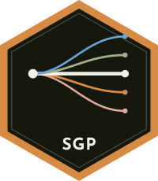

```{=html}
<section class="pkg-hero" aria-labelledby="pkg-name">
  
  <div>
    <p id="pkg-name" class="pkg-name" role="heading" aria-level="1">SGP</p>
    <p class="pkg-tagline">Student Growth Percentiles & Percentile Growth Trajectories</p>
    <ul class="pill-links">
  <li><a href="https://github.com/CenterForAssessment/SGP">GitHub</a></li>
  <li><a href="https://CRAN.R-project.org/package=SGP">CRAN</a></li>
  <li><a href="articles/SGP.html">Get started</a></li>
  <li><a href="reference/index.html">Reference</a></li>
    </ul>
  </div>
</section>
```

SGP
===


The SGP Package is open source software built for the [**R** software environment](https://www.r-project.org/). The classes, functions and data within the SGP package are used to calculate student growth percentiles and percentile growth projections/trajectories using large scale, longitudinal assessment data. Quantile regression is used to estimate the conditional density associated with each student's achievement history. Percentile growth projections/trajectories are calculated using the derived coefficient matrices and show the percentile growth needed to reach future achievement targets.


# Installation

## From [CRAN](https://CRAN.R-project.org/package=SGP)

To install the latest stable release of SGP from [CRAN](https://CRAN.R-project.org/package=SGP)

```R
> install.packages("SGP")
```

## From [Github](https://github.com/CenterForAssessment/SGP/)

To install the development release of SGP from [GitHub](https://github.com/CenterForAssessment/SGP/):

```R
> devtools::install_github("CenterForAssessment/SGP")
```


# Resources

* [SGP GitHub Pages](https://sgp.io)
* [CRAN Repo](https://CRAN.R-project.org/package=SGP)
* [Norm- and Criterion-Referenced Student Growth](https://github.com/CenterForAssessment/SGP_Resources/blob/master/articles/Betebenner_EMIP_2009.pdf)


# Contributors

The SGP Package is crafted with :heart: by:

* [Damian Betebenner](https://github.com/dbetebenner)
* [Adam R. Van Iwaarden](https://github.com/adamvi)
* [Ben Domingue](https://github.com/ben-domingue)
* [Yi Shang](https://github.com/shangyi)

We love feedback and are happy to answer questions.


# References

Betebenner, D. W., VanIwaarden, A., Domingue, B., and Shang, Y. (2026). SGP: Student Growth Percentiles & Percentile Growth Trajectories.

R Core Team (2025). R: A language and environment for statistical computing. R Foundation for Statistical Computing, Vienna, Austria. URL
https://www.R-project.org/.

